# Guia de Mermaid para Confluence

Referência de sintaxe dos tipos de diagrama mais usados em documentação técnica, com boas práticas para páginas do Confluence. Para converter e publicar, veja o [README.md](README.md).

## Introdução

Mermaid é uma linguagem de diagramação baseada em texto. Entre as vantagens para documentação versionada:

- o diagrama é texto puro, com diff legível no controle de versão;
- não exige ferramenta gráfica;
- integra-se ao Markdown como bloco de código;
- renderiza no Confluence pela macro Mermaid for Confluence.

## Sintaxe básica

Um diagrama é um bloco de código com a linguagem `mermaid`. A primeira linha declara o tipo:

````markdown
```mermaid
TIPO
    definições
    relações
```
````

Tipos tratados neste guia: `graph`/`flowchart`, `sequenceDiagram`, `classDiagram`, `stateDiagram-v2`, `erDiagram`, `gantt`. A macro também renderiza `pie`, `journey`, `gitGraph`, `mindmap`, `timeline` e `quadrantChart`; há exemplos de todos em `examples/all-diagrams.md`.

## Tipos de diagrama

### Fluxogramas

Direções: `TD` ou `TB` (de cima para baixo), `LR` (da esquerda para a direita), `BT` e `RL`.

Formas de nó:

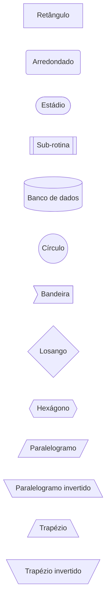

Tipos de seta:

```mermaid
graph LR
    A --> B
    C --- D
    E -.-> F
    G ==> H
    I --texto--> J
    K -.texto.-> L
    M ==texto==> N
```

Subgrafos:

````markdown
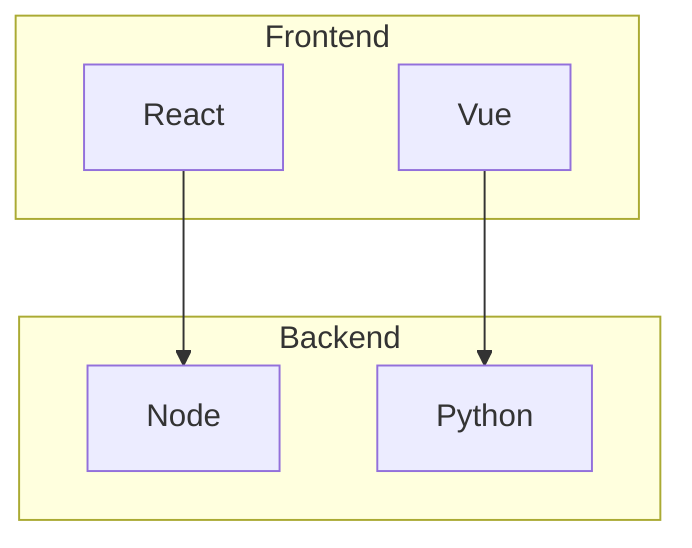
````

### Diagramas de sequência

Elementos principais:

````markdown
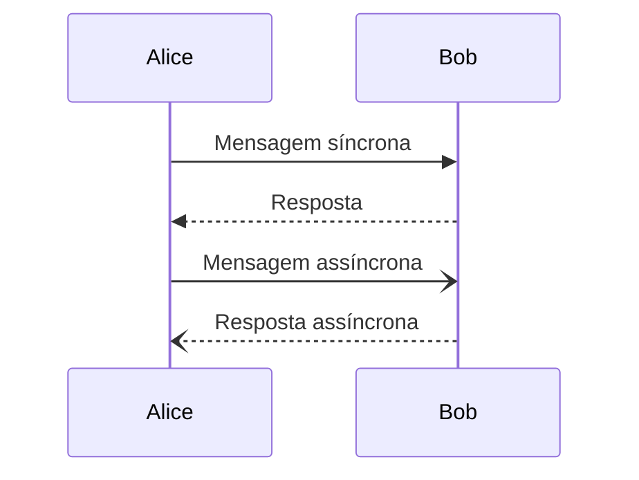
````

Recursos adicionais (numeração, ativação, alternativas, laços e notas):

````markdown
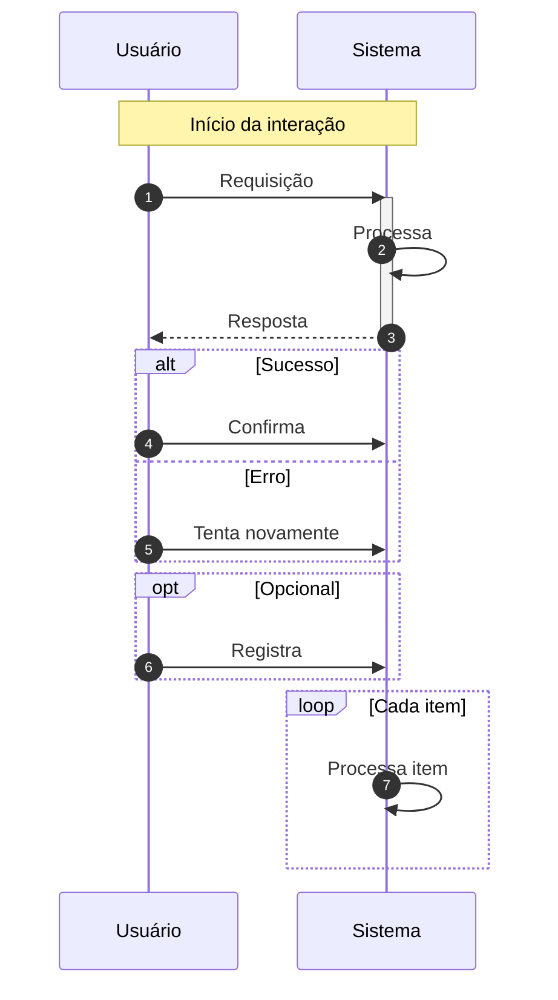
````

Tipos de seta:

- `->` linha sólida sem ponta
- `-->` linha pontilhada sem ponta
- `->>` linha sólida com ponta
- `-->>` linha pontilhada com ponta
- `-x` linha sólida com X (erro)
- `--x` linha pontilhada com X
- `-)` linha sólida assíncrona
- `--)` linha pontilhada assíncrona

### Diagramas de classes

````markdown
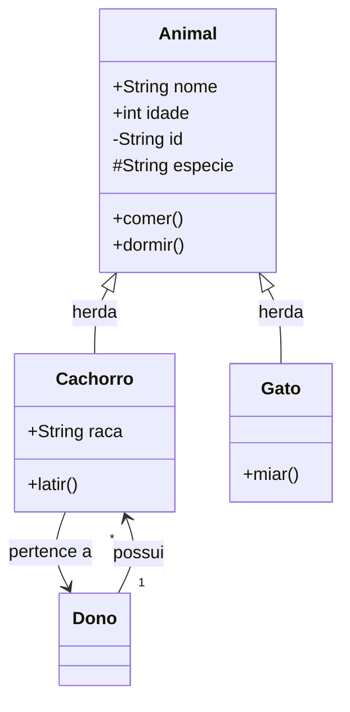
````

Visibilidade: `+` pública, `-` privada, `#` protegida, `~` de pacote.

Relações: `<|--` herança, `*--` composição, `o--` agregação, `-->` associação, `--` ligação, `..>` dependência, `..|>` realização.

Cardinalidade: `"1"` exatamente um, `"0..1"` zero ou um, `"1..*"` um ou mais, `"*"` muitos, `"n"` variável.

### Diagramas de estado

````markdown
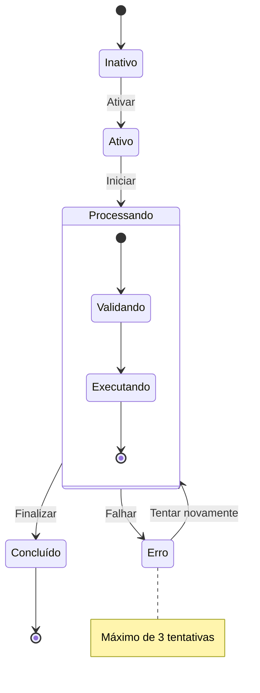
````

### Diagramas entidade-relacionamento

````markdown
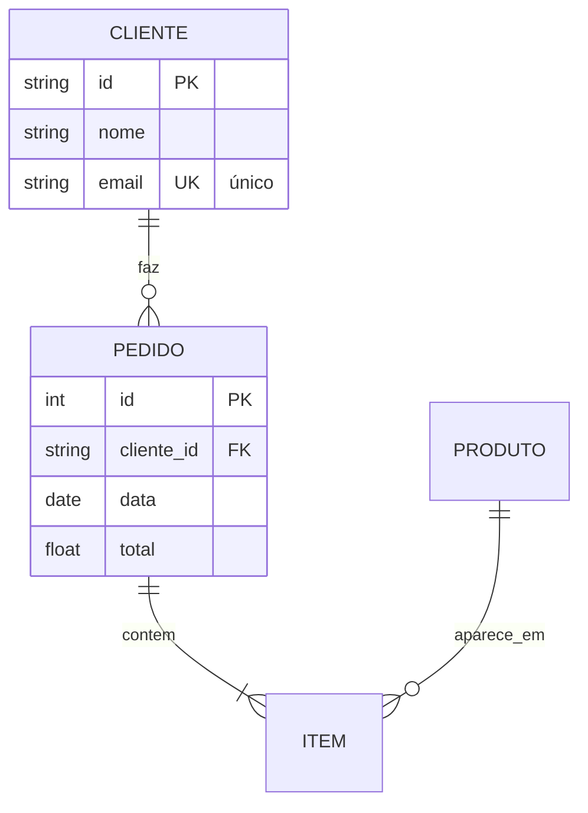
````

Cardinalidade: `||` exatamente um, `|o` zero ou um, `}|` um ou muitos, `}o` zero ou muitos.

Atributos: `PK` chave primária, `FK` chave estrangeira, `UK` chave única.

### Gráficos de Gantt

````markdown
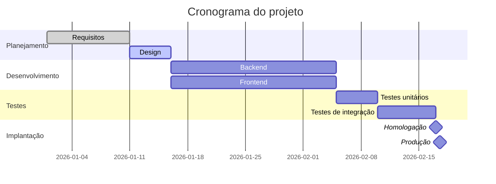
````

Estados: `done` concluído, `active` em andamento, `crit` crítico, `milestone` marco.

## Estilização

Cores por nó:

````markdown
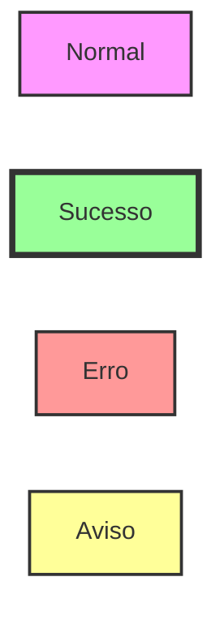
````

Classes de estilo reutilizáveis:

````markdown
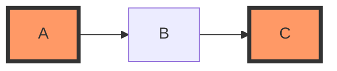
````

Paleta sugerida para semântica consistente entre diagramas:

```text
fill:#90EE90   verde claro, sucesso
fill:#FFB6C1   rosa claro, erro
fill:#FFD700   amarelo, aviso
fill:#87CEEB   azul claro, informação
fill:#DDA0DD   roxo claro, destaque
```

Temas (a diretiva precisa ser a primeira linha do bloco):

````markdown
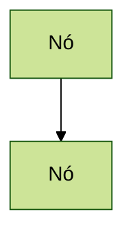
````

Temas disponíveis: `default`, `forest`, `dark`, `neutral`, `base`.

## Boas práticas

Recomendado:

1. Manter cada diagrama com uma responsabilidade e no máximo 15 a 20 nós; dividir quando crescer.
2. Usar nomes descritivos nos nós (`ServicoDeUsuarios`, não `SU`).
3. Agrupar elementos relacionados em subgrafos.
4. Manter uma direção consistente (de cima para baixo ou da esquerda para a direita).
5. Usar estilo apenas para destacar o que importa, com a mesma paleta em todas as páginas.
6. Validar a sintaxe no [Mermaid Live Editor](https://mermaid.live/) antes de publicar.

Evitar:

1. Diagramas com dezenas de nós em uma única figura.
2. Abreviações que só o autor entende.
3. Misturar níveis de abstração (arquitetura de alto nível com detalhes de implementação) no mesmo diagrama.
4. Setas cruzadas em todas as direções; reordenar os nós ou usar subgrafos resolve a maioria dos casos.

## Solução de problemas

### O diagrama não renderiza

Causas prováveis: erro de sintaxe, macro Mermaid for Confluence não instalada no site, ou ADF gerado sem o nó de macro. Teste a sintaxe no Live Editor, confirme a macro com o administrador do site e gere o ADF com o conversor do pacote.

### Texto cortado ou sobreposto

Rótulos longos. Quebre o texto com aspas e `<br/>`:

````markdown

````

### Setas confusas

Muitas conexões cruzadas. Reorganize a ordem de declaração dos nós ou agrupe em subgrafos.

## Exemplos práticos

### Autenticação

````markdown
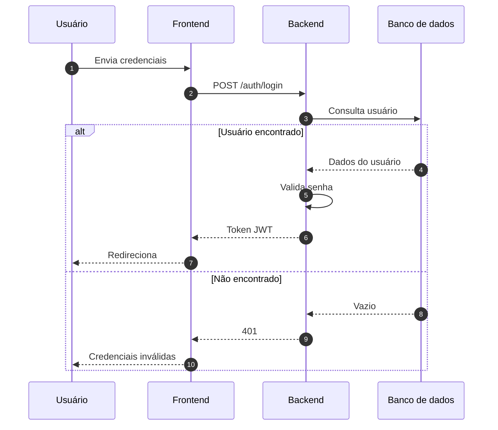
````

### Máquina de estados de um pedido

````markdown
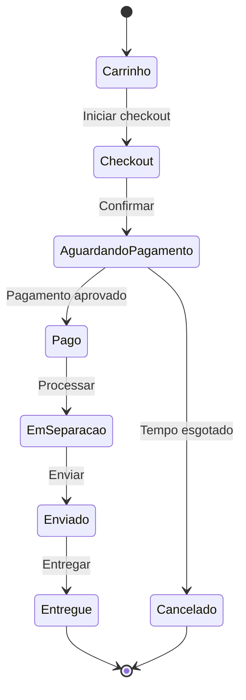
````

### Arquitetura de microsserviços

````markdown
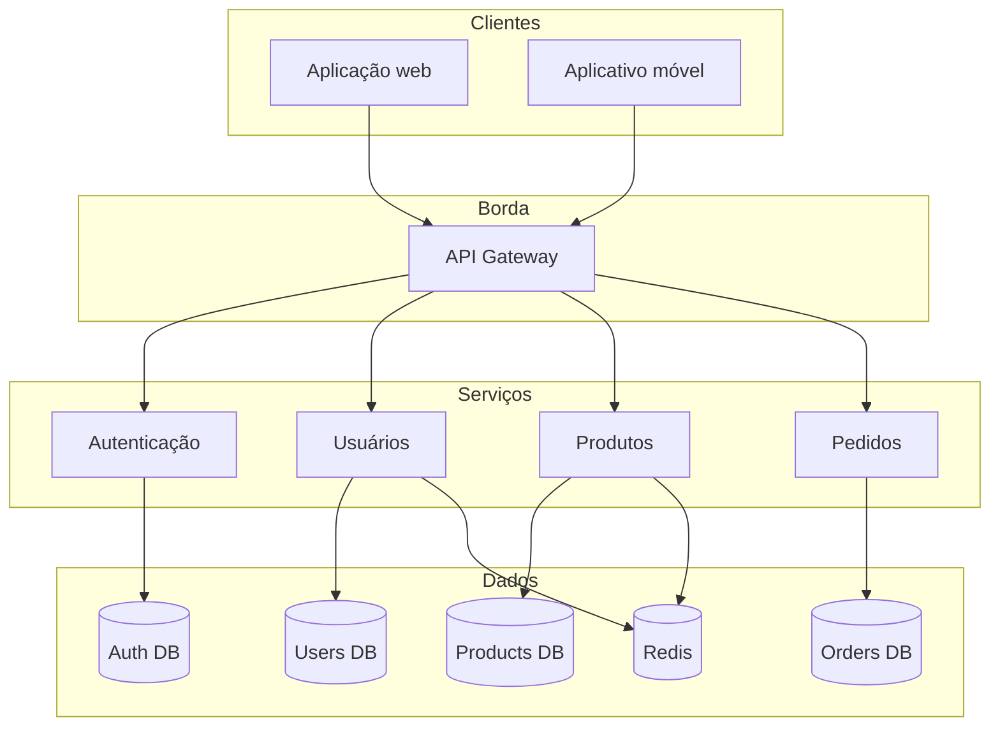
````

## Links em nós

Nós podem apontar para URLs. A abertura do link depende da macro e das permissões do site:

````markdown
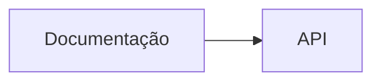
````

## Referências

- [Documentação do Mermaid](https://mermaid.js.org/)
- [Referência de sintaxe](https://mermaid.js.org/intro/syntax-reference.html)
- [Mermaid Live Editor](https://mermaid.live/)
- [Mermaid for Confluence](https://marketplace.atlassian.com/apps/1222792/mermaid-for-confluence)
- [Confluence REST API v2](https://developer.atlassian.com/cloud/confluence/rest/v2/intro/)
